<div align="center">
  
  <h1>AEGIS — Project Sentinel</h1>
  <p><strong>Machine-learning screening for near-Earth object hazard patterns</strong></p>
  <p>
    <a href="https://aegis-project-sentinel.vercel.app/" target="_blank" rel="noreferrer">
      
    </a>
    <a href="https://github.com/murtazasojar35-crypto/AEGIS-Project-Sentinel" target="_blank" rel="noreferrer">
      
    </a>
  </p>
  <p>
    
    
    
    
  </p>
</div>

AEGIS — Project Sentinel is a simple machine-learning web application that evaluates near-Earth object (NEO) inputs and classifies them as `Hazardous` or `Non-hazardous` using a trained XGBoost model. It is designed as an educational, browser-based demonstration of how a small hazard-screening workflow can combine a frontend, a FastAPI backend, and a saved ML artifact.

The project focuses on clarity and accessibility rather than operational risk forecasting. The model is a screening aid for learning and demonstration, not a real-world impact-probability model or a professional orbital-risk assessment.

## Table of contents

- [What AEGIS Project Sentinel does](#what-aegis-project-sentinel-does)
- [Why this project is useful](#why-this-project-is-useful)
- [How a user interacts with the app](#how-a-user-interacts-with-the-app)
- [What the model actually uses](#what-the-model-actually-uses)
- [Workflow and prediction behavior](#workflow-and-prediction-behavior)
- [Project structure](#project-structure)
- [Local installation guide](#local-installation-guide)
- [Deployment guide](#deployment-guide)
- [Testing and development workflow](#testing-and-development-workflow)
- [Troubleshooting](#troubleshooting)
- [Scientific disclaimer](#scientific-disclaimer)

## What AEGIS Project Sentinel does

This repository contains a small full-stack project that:

- accepts a few asteroid-like measurements from a browser form,
- validates the inputs on the backend,
- transforms those values into the model's expected features,
- runs inference with a saved XGBoost classifier,
- returns a hazard label and score, and
- optionally classifies many rows from a CSV upload.

The app is intentionally lightweight and beginner-friendly. It illustrates the end-to-end structure of a practical ML application without hiding the fact that the model is a limited educational screening tool.

## Why this project is useful

This project is useful as an educational machine-learning demonstration because it shows a real workflow in a compact repo:

- a frontend collects input data,
- a backend validates and serves predictions,
- a saved model artifact performs inference,
- a small test suite checks the API behavior,
- the model metadata is available in `artifacts/model_card.json`.

It is especially useful for students, recruiters, and learners who want to see how a concept like feature engineering, model loading, and web deployment come together in a working Python project.

## How a user interacts with the app

A user opens the deployed site, enters three values in the web form, and clicks the analysis button. The backend accepts the request only if the values are within the ranges enforced by the app. It then computes the final classification and shows:

- the predicted label (`Hazardous` or `Non-hazardous`),
- the model score from 0 to 1,
- the estimated diameter from the absolute magnitude,
- the miss distance relative to the Moon,
- and the threshold used to make the final decision.

The app also includes a what-if analysis section, which varies one feature at a time while holding the others constant, and a batch upload flow for CSV classification.

## What the model actually uses

The backend reads the model from `artifacts/sentinel_model.joblib` and the metadata from `artifacts/model_card.json`. The application validates the expected inputs before calling the estimator.

The actual numeric inputs are:

| Input field | Type | Verified range in code | Meaning |
| --- | --- | --- | --- |
| `absolute_magnitude` | float | 9 to 34 | Brightness measure; lower values usually indicate a larger object. |
| `relative_velocity` | float | 100 to 250000 km/h | Speed of the object relative to Earth in the flyby scenario. |
| `miss_distance` | float | 1,000 to 80,000,000 km | Distance between the object and Earth at closest approach. |

The feature engineering used by the app is:

- `log_velocity = log10(relative_velocity)`
- `log_miss_distance = log10(miss_distance)`
- `log_size_dist_ratio = log10(d / miss_distance)`

where `d` is a rough diameter estimate derived from absolute magnitude using the same albedo assumption used in the code and training pipeline. This means the model is not using raw orbital physics such as MOID or a full ephemeris solution; it uses a simplified feature set and the model's learned relationship between size, speed, and close approach distance.

## Workflow and prediction behavior

The application does the following in order:

1. The user opens the deployed web app.
2. The frontend gathers `absolute_magnitude`, `relative_velocity`, and `miss_distance`.
3. The browser sends a JSON request to the backend endpoint.
4. The FastAPI backend validates the request using Pydantic constraints and the model's allowed feature ranges.
5. The saved model loads from the `artifacts/` directory and runs `predict_proba` on the featurized values.
6. The app compares the resulting score to the threshold from the saved model metadata and returns a label.
7. The frontend displays the result and any supporting values, such as estimated size and relative miss distance.

The main prediction endpoint is:

- `POST /api/predict`

Request format:

```json
{
  "absolute_magnitude": 17.5,
  "relative_velocity": 90000,
  "miss_distance": 5000000
}
```

Response format:

```json
{
  "label": "Hazardous",
  "score": 0.6421,
  "diameter_m": 1250.0,
  "miss_ld": 0.013,
  "threshold": 0.59
}
```

The app also supports:

- `GET /api/info` to inspect model readiness, feature metadata, threshold, and importances,
- `GET /api/template` to download a CSV template,
- `POST /api/batch` to upload a CSV file of rows, and
- `POST /api/sensitivity` to vary a single input while holding others fixed.

### Mermaid workflow

```mermaid
flowchart LR
    A[User opens web application] --> B[Enter absolute_magnitude, relative_velocity, miss_distance]
    B --> C[Frontend sends request to /api/predict]
    C --> D[FastAPI validates inputs]
    D --> E[Load XGBoost model from artifacts/sentinel_model.joblib]
    E --> F[Featurize values with log transforms]
    F --> G[Model returns hazard score]
    G --> H[Compare score to threshold]
    H --> I[Display Hazardous or Non-hazardous result]
```



### How to interpret the output

The model returns a score between 0 and 1. In this project, a score above the saved threshold (`0.59`) is labeled `Hazardous`, while lower scores are labeled `Non-hazardous`.

This is a classification output from a trained model, not a direct estimate of impact probability or collision risk. In the code, the threshold and label logic are explicit, but the scientific meaning remains limited to the project's simplified training setup.

## Project structure

```text
AEGIS-Project-Sentinel/
├── README.md
├── main.py
├── requirements.txt
├── requirements-dev.txt
├── test_app.py
├── static/
│   ├── index.html
│   ├── aegis-mark.svg
│   └── favicon.svg
├── artifacts/
│   ├── sentinel_model.joblib
│   └── model_card.json
├── hazardous_asteroid_prediction_final.ipynb
├── neo (3).csv
├── .python-version
├── .vercelignore
├── .gitignore
└── .pytest_cache/
```

Key files and purpose:

- `main.py` — the FastAPI application, model loading logic, input validation, and all API routes.
- `static/index.html` — the browser interface for single-object analysis, what-if exploration, and CSV uploads.
- `artifacts/sentinel_model.joblib` — the trained XGBoost model used at runtime.
- `artifacts/model_card.json` — saved model metadata including the threshold and evaluation information.
- `requirements.txt` — production Python dependencies required to run the app.
- `requirements-dev.txt` — dev/test dependencies, including pytest and supporting packages.
- `test_app.py` — automated tests for artifact loading, prediction behavior, batch processing, and root-page serving.
- `hazardous_asteroid_prediction_final.ipynb` — project notebook related to the training and experiment workflow.
- `neo (3).csv` — dataset file present in the repo; not required for daily app usage but included in the project context.

## Local installation guide

These steps were verified against the project structure and the code in `main.py`.

### 1) Clone the repository

```powershell
git clone https://github.com/murtazasojar35-crypto/AEGIS-Project-Sentinel.git
cd AEGIS-Project-Sentinel
```

### 2) Create a Python virtual environment

```powershell
python -m venv .venv
```

### 3) Activate the environment in PowerShell

```powershell
.\.venv\Scripts\Activate.ps1
```

If PowerShell blocks the script, use:

```powershell
Set-ExecutionPolicy -Scope Process -ExecutionPolicy Bypass
.\.venv\Scripts\Activate.ps1
```

### 4) Install production dependencies

```powershell
python -m pip install --upgrade pip
python -m pip install -r requirements.txt
```

### 5) Run the app locally

From the repository root, use:

```powershell
python -m uvicorn main:app --reload
```

This is the correct startup command for the FastAPI app defined in `main.py`.

### 6) Open the local app

Once the server is running, open:

```text
http://127.0.0.1:8000
```

The frontend and API are served from the root application. The live public demo is at:

- [https://aegis-project-sentinel.vercel.app/](https://aegis-project-sentinel.vercel.app/)

### 7) Stop the server

Stop the local server with `Ctrl + C` in the terminal where `uvicorn` is running.

### 8) Install test dependencies and run the test suite

```powershell
python -m pip install -r requirements-dev.txt
python -m pytest -v
```

This repository includes a small automated test suite in `test_app.py` and uses `pytest`.

## Deployment guide

The project is currently deployed on Vercel at the live URL above. The repository does not include a custom `vercel.json` or a dedicated Python deployment configuration file, so the deployment depends on standard project structure and the app's Python runtime rather than extra build tooling.

### Prerequisites

Before deploying:

- a GitHub account and a Vercel account,
- the repository cloned locally or already hosted on GitHub,
- Python project files present in the root directory,
- the saved model artifacts present in `artifacts/`.

### Connect the repository to Vercel

1. Sign in to Vercel.
2. Click "Add New Project".
3. Import this GitHub repository.
4. Keep the repository root as the project directory.
5. If Vercel asks for a framework or build command, use the repository's actual Python app structure rather than a static-only setup. This project runs as a FastAPI app from `main.py` and should be deployed with Python/Uvicorn behavior in mind.

### Runtime and build configuration

The application is not a classic static-only frontend. It includes:

- a FastAPI backend in `main.py`,
- a browser frontend in `static/index.html`,
- local model files in `artifacts/`, and
- a Python dependency list in `requirements.txt`.

No custom environment variables are referenced in the source code. The app reads the model from the local repository paths and does not require additional secrets for normal operation.

In practice, the deployment should use the repository root and the Python app startup pattern that matches the local run command:

```powershell
python -m uvicorn main:app --host 0.0.0.0 --port 8000
```

### Deploying and testing the live app

After connecting the repo and selecting the project root, trigger a deployment. Once the build finishes, open the Vercel-generated URL and verify:

- the root page loads,
- the UI renders,
- the model loads successfully,
- a prediction request works,
- the API responds without a 503 on model-load failure.

A successful Vercel deployment should show the app served by the root route, while the underlying ML functionality still depends on the `artifacts/` directory being included in the deployed project.

### Logs and troubleshooting

If a deploy fails, review the Vercel build logs and check:

- whether `requirements.txt` was detected,
- whether `main.py` is present at the root,
- whether the app command matches the actual FastAPI import path,
- whether `artifacts/sentinel_model.joblib` is available in the deployed project,
- and whether the app is trying to serve a static frontend and backend together without an incompatible runtime configuration.

### Redeploying after changes

After pushing changes to the configured branch, Vercel will usually trigger a new deployment automatically. If it does not, redeploy manually from the Vercel dashboard.

## Testing and development workflow

A practical contributor workflow for this repository is:

### 1) Create a feature branch

```powershell
git checkout -b feature/my-update
```

### 2) Make a small change

Edit the relevant file, keep the scope narrow, and avoid changing model files or runtime behavior without a clear reason.

### 3) Run the tests

```powershell
python -m pytest -v
```

### 4) Check the diff and formatting state

```powershell
git --no-pager diff -- README.md
git --no-pager diff --check
```

The repo uses a small pytest-based API and frontend smoke suite in `test_app.py` rather than a large CI pipeline.

### 5) Commit the change

```powershell
git add .
git commit -m "Describe the update"
```

### 6) Push the branch

```powershell
git push origin feature/my-update
```

### 7) Open a pull request or merge through GitHub

Use the GitHub web interface to open a pull request or merge the branch after review.

### 8) Verify the Vercel deployment

After merge or push to the configured branch, confirm the live Vercel deployment still loads and behaves as expected.

CI or GitHub Actions are not currently present in this repository; if you want to add automated quality checks in the future, that would be a sensible improvement.

## Troubleshooting

### Python not found

- Install Python 3.12 or the version required by your local environment.
- If Windows is using the Python launcher, try:

```powershell
py -3.12 --version
```

### Virtual environment activation errors in PowerShell

- If activation is blocked, run:

```powershell
Set-ExecutionPolicy -Scope Process -ExecutionPolicy Bypass
.\.venv\Scripts\Activate.ps1
```

- If the environment is not created yet, run:

```powershell
python -m venv .venv
```

### Missing dependencies

- Reinstall the project dependencies:

```powershell
python -m pip install -r requirements.txt
python -m pip install -r requirements-dev.txt
```

### Incorrect Uvicorn module path

This project must be started from the repo root with:

```powershell
python -m uvicorn main:app --reload
```

The app object is defined in `main.py`, so `main:app` is the correct import path.

### Missing or incompatible model artifacts

The backend expects `artifacts/sentinel_model.joblib` and `artifacts/model_card.json` to be present and readable. If the app shows a model-load error, check that the files still exist and that the project is running from the expected repository root.

### API errors

- `400` responses usually indicate a missing or invalid column set for CSV upload or request validation.
- `422` responses usually indicate a request that violates the FastAPI schema constraints.
- `503` is raised by the code when the model cannot be loaded.

### Vercel build or runtime failures

Check the Vercel logs for:

- missing Python dependency installation,
- inability to locate the app entrypoint,
- missing model files in deployment,
- or a runtime mismatch between the deployed app command and the actual project structure.

### Slow first response or slow page loading

A slow first response is possible on cold starts because the app loads the model at startup. This is expected behavior for a model-backed application, and it is not a README issue or a deployment bug by itself.

## Scientific disclaimer

AEGIS — Project Sentinel is an educational and experimental screening model. It is designed to help users explore how a trained classifier can distinguish hazard-like patterns from non-hazardous examples, but the output should not be interpreted as:

- a real-world collision probability,
- a professional orbital-risk assessment,
- an official warning system,
- or a decision-making tool for planetary defense operations.

The model is intentionally limited to a small set of simplified features: absolute magnitude, relative velocity, and miss distance. It does not account for the full orbital context used in formal asteroid-risk analysis.

The application is best understood as a learning-focused demonstration of ML inference and frontend-backend integration, not as a production-grade asteroid-risk platform.
